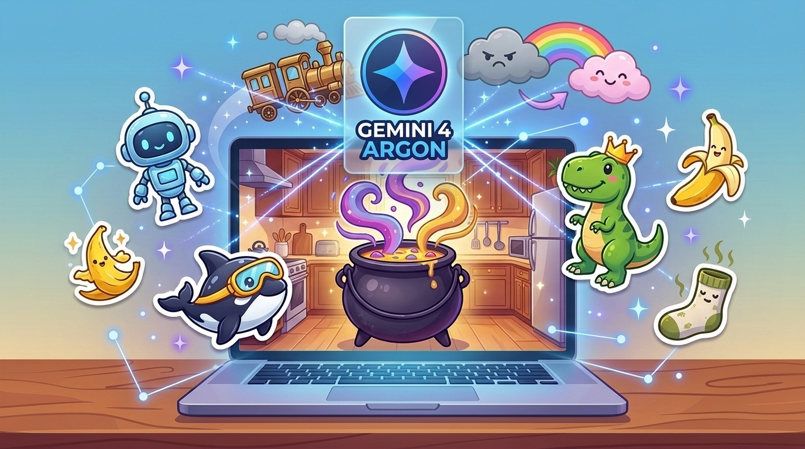
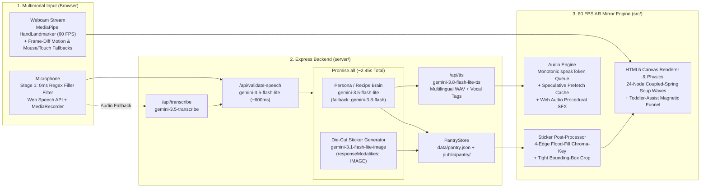
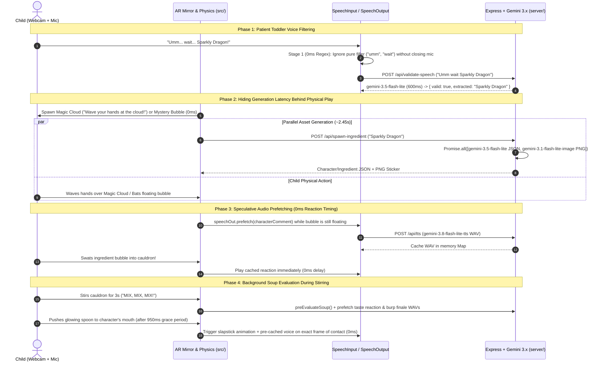
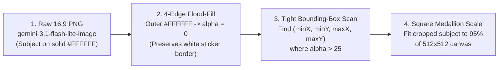

# ToddlerGames: Silly Chef & Flying Train

An interactive **AR Mirror and Voice-Powered Arcade** built for 4-year-olds using the **Google Gemini 3.x Multimodal Stack** (`@google/genai`) and **MediaPipe Hand Tracking** (`@mediapipe/tasks-vision`).



> **Read the full engineering story on Medium:** [Previewing Gemini 4 Argon by Building an AR Game for My 4-Year-Old](https://medium.com/@terraccianosaverio/previewing-gemini-4-argon-by-building-an-ar-game-for-my-4-year-old-baf198896cd8)

Instead of relying on a mouse, keyboard, or text menus, children see themselves reflected inside a live illustrated world on webcam. Their real hands act as magic wands, wooden spoons, and airplane controls, while their voice summons custom cartoon characters, soup ingredients, and silly cannon ammo in real time.

---

## Game Modes

The arcade includes two playable modes that share a unified **Persistent Sticker Toybox**:

1. **Magic Soup (`CAULDRON` Mode):**
   * **Summon a Hungry Guest:** Shout any character idea into the microphone (or tap a saved friend on the left shelf). Wave your hands over the **Magic Cloud** on the webcam mirror to wake them up!
   * **Shout & Swat 3 Ingredients:** Invent any real or silly ingredient (*"Sparkly Dragon"*, *"Bouncing Banana"*, *"Smelly Sock"*) and swat the floating bubble into the bubbling cast-iron cauldron.
   * **Stir the Pot:** Move your hands in big circles over the cauldron while chanting *"MIX, MIX, MIX!"* to excite real-time coupled-spring liquid waves.
   * **Feed & Transform:** Push the glowing magic spoon into the character's mouth to trigger one of **6 Slapstick Reactions** (*Rainbow Disco Dance*, *Super Spicy Fire Breath*, *Brain Freeze Ice Cube*, *Stinky Wobbly Green*, *Balloon Float*, or *Giant Screen-Shaking Stomp*) followed by a **Bubble Burp Finale**.
2. **Flying Train (`FLYING_TRAIN` Mode):**
   * **AR Hand Steering:** Move your hands on the webcam mirror to steer a winged steam locomotive up and down through the sky.
   * **Voice-Invented Silly Cannon Ammo:** Shout anything to load the brass Smokestack Cannon. A glowing Mystery Ball loads in `0ms` so you can start firing immediately, then hot-swaps mid-air as soon as the custom die-cut sticker finishes generating.
   * **Cheer Up Grumpy Storm Clouds:** Blast rumbling grey storm clouds 3 times with silly treats to transform them into smiling **Happy Rainbow Cotton-Candy Clouds**, culminating in a **Giant Golden Pinata Cloud** boss and a sky bubble-popping party.

---

## System Architecture



### Gemini 3.x Runtime Model Stack

| Capability | Primary Model | Fallback Model | Purpose & Latency Profile |
| :--- | :--- | :--- | :--- |
| **Intent & Structured JSON** | `gemini-3.5-flash-lite` | `gemini-3.8-flash` | Validates toddler speech, extracts intent from hesitation filler, and generates structured JSON character personas, ingredient properties, and soup evaluations in `~600ms`. |
| **Live Die-Cut Stickers** | `gemini-3.1-flash-lite-image` | `gemini-nano-banana-2.1` | Generates 2D cartoon stickers with `responseModalities: ['IMAGE']` in `~2.4s`. Paired with `gemini-3.5-flash-lite` inside `Promise.all` to keep total spawn latency at `~2.45s`. |
| **Expressive Multilingual TTS** | `gemini-3.8-flash-lite-tts` | Browser `speechSynthesis` | Synthesizes character voices (`Puck`, `Kore`, `Fenrir`, `Charon`, etc.) with inline vocal tags (`<laugh>`, `<giggle>`, `<gasp>`, `<sigh>`) across any language (English, Italian, Portuguese, etc.). |
| **Speech-to-Text Fallback** | `gemini-3.5-transcribe` | Web Speech API | Captures parallel `MediaRecorder` audio to transcribe soft or high-pitched toddler speech when browser recognition drops out. |

---

## Zero-Wait Toddler UX & Latency Hiding

Four-year-olds think out loud (*"umm... wait... you say it!"*) and lose interest if an interaction stalls on a loading spinner. The engine hides network latency behind physical gameplay and speculative execution:



### Die-Cut Sticker Post-Processing Pipeline (`src/game/stickerUtils.ts`)

Image generation models often bake a visible checkerboard pattern into PNGs when asked for a transparent background, and `gemini-3.1-flash-lite-image` returns `16:9` canvases where the centered subject occupies ~25% of the width. To turn raw outputs into crisp, transparent toy medallions on the client:



---

## Codebase Structure

```text
├── .env.example              # Environment variable template (API key & model IDs)
├── index.html                # Toybox UI overlay (Friends/Pantry shelves, mode switcher, AR canvas)
├── package.json              # Scripts and dependencies (@google/genai, @mediapipe/tasks-vision, Express, Vite)
├── tsconfig.json             # Strict TypeScript configuration
├── vite.config.ts            # Vite dev server with /api and /pantry proxy to port 3001
├── server/
│   ├── index.ts              # Express API server (/api/pantry, /api/validate-speech, /api/summon-character,
│   │                         # /api/spawn-ingredient, /api/evaluate-soup, /api/tts, /api/transcribe)
│   ├── gemini.ts             # GoogleGenAI orchestration, parallel JSON + image generation, RIFF WAV header
│   │                         # detection, speech validation, and offline procedural fallbacks
│   └── pantryStore.ts        # Local JSON + PNG persistence (data/pantry.json & public/pantry/) + starter items
└── src/
    ├── main.ts               # Game state machine (CAULDRON & FLYING_TRAIN modes), speculative TTS prefetching,
    │                         # voice onboarding, and turn-taking orchestration
    ├── types.ts              # Shared TypeScript interfaces for phases, characters, ingredients, and physics
    ├── style.css             # Glossy 3D sticker medallion shelves, storybook pill banner, and responsive layout
    ├── vision/
    │   └── handTracker.ts    # MediaPipe HandLandmarker GPU tracker (up to 4 hands), 320x240 frame-differencing
    │                         # motion fallback, and mouse/touch wand
    ├── audio/
    │   ├── soundEffects.ts   # Zero-dependency Web Audio API procedural sound synthesizer (splashes, chimes,
    │   │                     # bubbling cauldron, cannon pops, transformations, cartoon burps, fanfare)
    │   ├── speechInput.ts    # Continuous 25s toddler listening window, 2-stage hesitation filter, and
    │   │                     # parallel MediaRecorder fallback to gemini-3.5-transcribe
    │   └── speechOutput.ts   # Monotonic speakToken single-voice TTS player, in-memory WAV prefetch cache,
    │                         # mic auto-mute hooks, and browser speechSynthesis fallback
    └── game/
        ├── physics.ts        # 24-node coupled-spring Hooke's law soup wave solver, elastic squash-and-stretch,
        │                     # magnetic cauldron funnel, 950ms spoon grace period, and Flying Train cloud waves
        ├── renderer.ts       # 60 FPS HTML5 Canvas renderer (mirrored AR webcam, 3D cauldron, hearth flames,
        │                     # 6 slapstick character transformations, and two-pass translucent sky clouds)
        ├── stickerUtils.ts   # Client-side 4-edge flood-fill chroma-keying, tight bounding-box auto-cropper,
        │                     # and procedural SVG fallback sprites
        └── pantryUI.ts       # Label-free 3D sticker medallion shelves for one-tap character/ammo selection
```

---

## Quick Start

### 1. Prerequisites
* **Node.js** `v20+` (tested with `v22`)
* A modern browser (**Chrome** or **Edge** recommended for WebGL MediaPipe hand tracking and Web Speech API)
* A **Google Gemini API Key** from [Google AI Studio](https://aistudio.google.com/apikey)

> **Note:** Even without a `GEMINI_API_KEY`, the game runs out-of-the-box in **Offline Starter Mode** using procedural SVG stickers, local recipe evaluation, and browser speech synthesis.

### 2. Installation & Environment Setup

Clone the repository and install dependencies:

```bash
git clone https://github.com/Tetsuoryuu/ToddlerGames.git
cd ToddlerGames
npm install
```

Create a `.env` file in the project root from `.env.example` (or set `GEMINI_API_KEY` as a system environment variable):

```bash
cp .env.example .env
```

Edit `.env` and add your Gemini API key:

```env
GEMINI_API_KEY=your_gemini_api_key_here
```

### 3. Run the Game

Start both the Express API server (`http://localhost:3001`) and the Vite frontend (`http://localhost:5173`) concurrently:

```bash
npm run dev
```

Open **`http://localhost:5173`** in your browser, allow **Webcam** and **Microphone** permissions, and choose **Magic Soup** or **Flying Train**!

### 4. Production Build

To type-check and build the production bundle into `dist/`:

```bash
npm run build
```

---

## License

[MIT](LICENSE)
